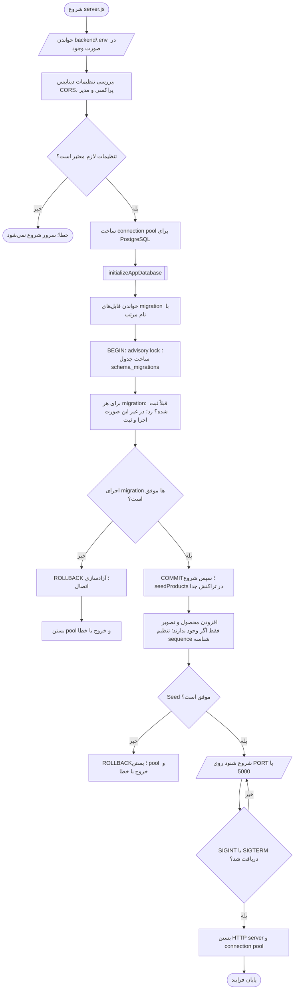
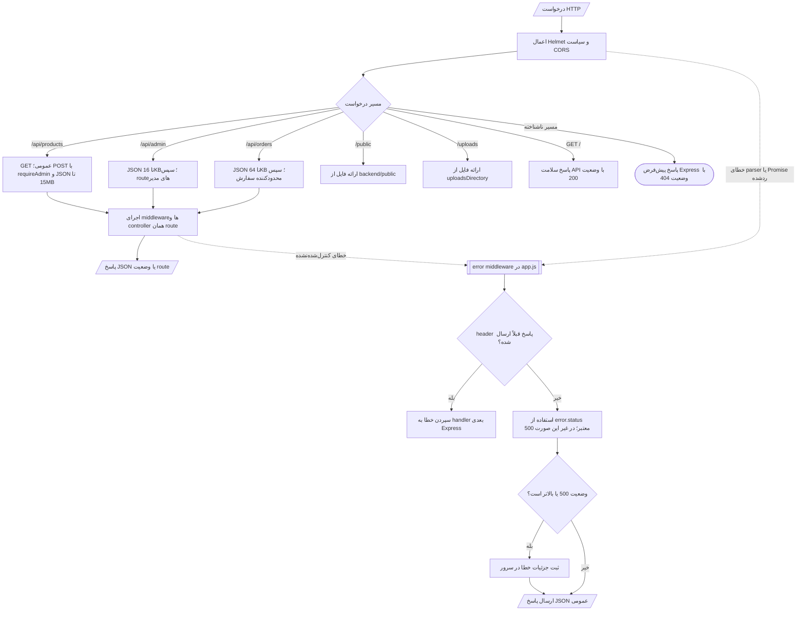
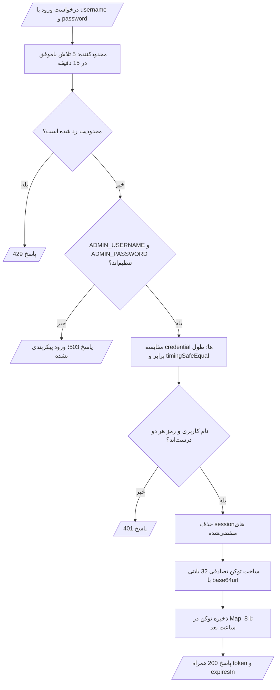
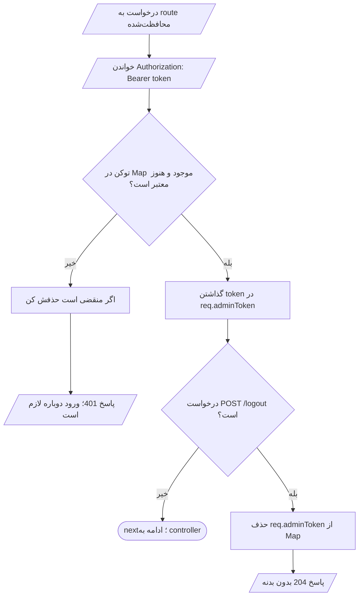
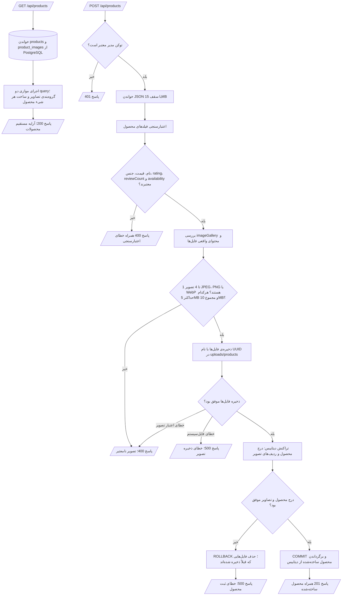
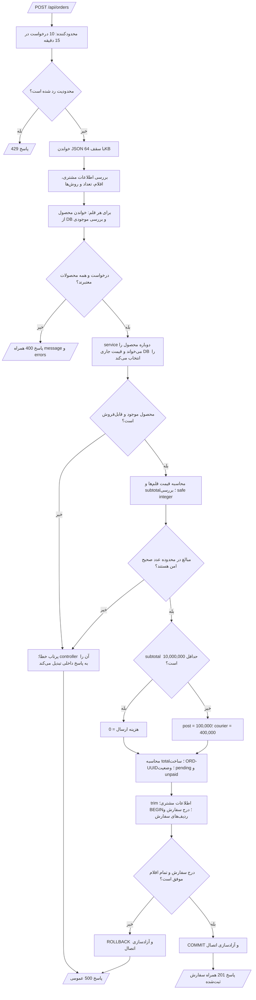
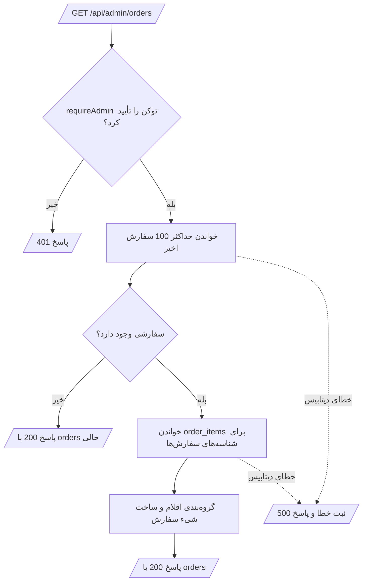
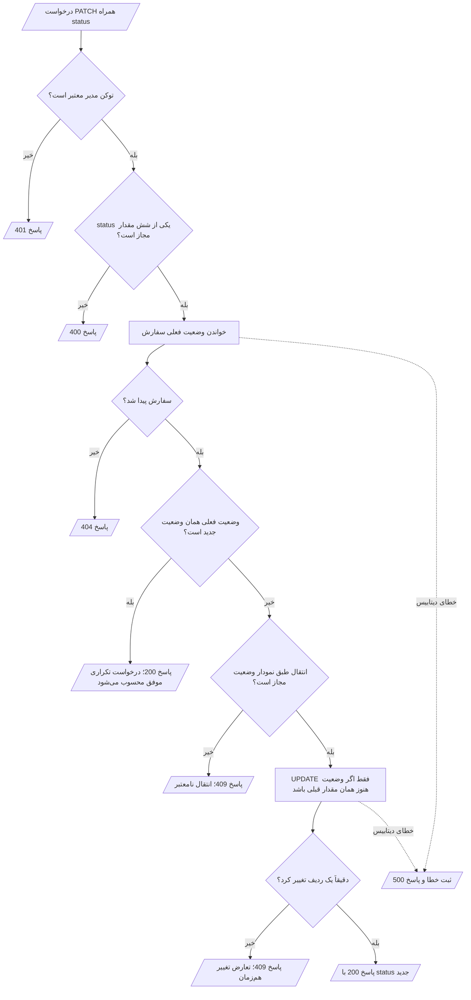
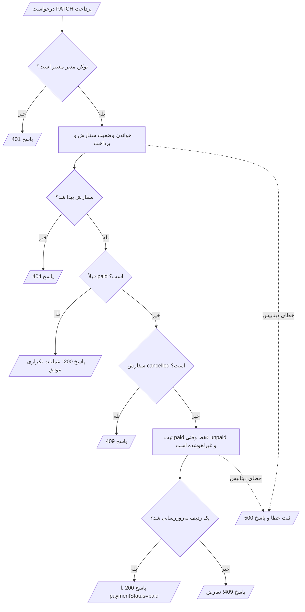

# فلوچارت کامل الگوریتم بک‌اند فامینا

این سند جریان فعلی کدهای `backend` را از شروع سرور تا پاسخ endpointها نشان می‌دهد. شکل‌ها از نمادهای رایج فلوچارت استفاده می‌کنند.

## راهنمای شکل‌ها

- `([ ... ])` شکل پایانیِ بیضی/کپسولی: شروع یا پایان
- `[/ ... /]` متوازی‌الأضلاع: ورودی یا خروجی
- `[ ... ]` مستطیل: پردازش
- `{ ... }` لوزی: شرط و انشعاب
- `[( ... )]` استوانه: پایگاه داده
- `[[ ... ]]` مستطیل دوجداره: زیرروال یا عملیات مستقل

## ۱. راه‌اندازی سرور و دیتابیس



تنظیمات دیتابیس باید `DATABASE_URL` یا ترکیب `PGHOST`، `PGDATABASE`، `PGUSER` و `PGPASSWORD` را داشته باشند. پورت پایگاه داده پیش‌فرض `5432` و اندازه‌ی pool پیش‌فرض `5` است. در صورت فعال بودن `DATABASE_SSL`، اتصال TLS با بررسی گواهی ساخته می‌شود. در محیط production، نام کاربری مدیر، رمز حداقل ۲۴ کاراکتری و `CORS_ORIGINS` لازم‌اند؛ `TRUST_PROXY_HOPS` نیز باید عدد صحیح نامنفی باشد.

فایل‌های migrationای که قبلاً در `schema_migrations` ثبت شده‌اند دوباره اجرا نمی‌شوند. Seed در هر شروع سرور اجرا می‌شود، اما `ON CONFLICT DO NOTHING` باعث می‌شود محصولات و تصاویر موجود بازنویسی نشوند. اگر migration یا seed شکست بخورد، تراکنش rollback می‌شود و سرور شروع به listen نمی‌کند.

## ۲. مسیر مشترک درخواست HTTP



درخواست‌های routeهای مدیر ابتدا JSON با سقف ۱۶KB می‌خوانند. سفارش‌ها سقف ۶۴KB دارند. برای ساخت محصول، `requireAdmin` پیش از JSON parser پانزده مگابایتی اجرا می‌شود. اگر بدنه از سقف مجاز بزرگ‌تر باشد، Express خطای `413` می‌سازد و error middleware پیام مخصوص حجم درخواست را می‌فرستد. خطاهای ۵۰۰ به بالا در سرور log می‌شوند؛ متن عمومی پاسخ، جزئیات داخلی خطا را افشا نمی‌کند.

## ۳. ورود مدیر و بررسی توکن

### ورود: `POST /api/admin/login`



محدودکننده فقط تلاش‌های ناموفق را حساب می‌کند؛ ورود موفق از شمارش آن پنجره کنار گذاشته می‌شود. فهرست sessionها در یک `Map` داخل حافظه‌ی همان فرایند Node نگهداری می‌شود، بنابراین با restart شدن سرور پاک می‌شود.

### route محافظت‌شده و خروج



## ۴. دریافت و ساخت محصول

### `GET /api/products` و `POST /api/products`



`validateProduct` نام را trim می‌کند؛ نام باید ۱ تا ۱۲۰ نویسه، قیمت عدد صحیح امن و نامنفی، جنس یکی از گزینه‌های مجاز، امتیاز بین ۰ تا ۵، تعداد نظر عدد صحیح امن و نامنفی، و موجودی boolean باشد. سرویس تصویر وجود ۱ تا ۴ تصویر را لازم می‌داند؛ `label` باید پس از trim خالی نباشد و حداکثر ۱۲۰ نویسه باشد؛ `dataUrl` باید base64 معتبر و از نوع JPEG، PNG یا WebP باشد. فایل خالی، بزرگ‌تر از سقف یا با امضای باینری ناسازگار با MIME رد می‌شود. فایل‌ها با نام UUID و بدون overwrite ذخیره می‌شوند و پاسخ محصول به‌جای base64، مسیرهایی مثل `/uploads/products/...` دارد.

اگر ذخیره‌ی یکی از فایل‌ها هنگام نوشتن ناقص بماند، سرویس تصویر فایل‌های همان تلاش را پاک می‌کند. اگر فایل‌ها ذخیره شوند ولی transaction دیتابیس شکست بخورد، Controller هم فایل‌های ذخیره‌شده را پاک می‌کند تا فایل یتیم باقی نماند.

## ۵. اعتبارسنجی و ثبت سفارش مشتری

### `POST /api/orders`



Validator بررسی می‌کند نام مشتری ۲ تا ۱۲۰ نویسه، موبایل بعد از حذف فاصله‌ها مطابق `^09\d{9}$`، استان و شهر ۱ تا ۱۰۰ نویسه، آدرس ۱۰ تا ۵۰۰ نویسه و یادداشت اختیاری حداکثر ۵۰۰ نویسه باشد. سفارش باید ۱ تا ۵۰ قلم داشته باشد؛ شناسه‌ی محصول عدد صحیح امن و مثبت و تعداد هر قلم بین ۱ تا ۱۰۰ است. محصول باید در دیتابیس وجود داشته و موجود باشد. روش‌های ارسال `post` و `courier` هستند؛ پرداخت فعلی `manual` است. اگر روش ارسال یا پرداخت ارسال نشود، validator به‌ترتیب `post` و `manual` را قرار می‌دهد.

مبالغ از قیمت فعلی دیتابیس حساب می‌شوند، نه از قیمت ارسالی مرورگر. هزینه‌ی ارسال وقتی subtotal حداقل ۱۰ میلیون باشد صفر است؛ پایین‌تر از آن، هزینه بر اساس روش ارسال انتخاب می‌شود. شناسه‌ی سفارش با UUID ساخته می‌شود و زمان ساخت به ISO تبدیل می‌شود. نام، استان، شهر و آدرس trim می‌شوند؛ فاصله‌های موبایل حذف می‌شوند و یادداشت خالی ذخیره نمی‌شود. service محصول‌ها را پس از validator دوباره می‌خواند تا قیمت و موجودی زمان ثبت سفارش را بررسی کند. خطایی که در این مرحله پرتاب شود، در Controller فعلی به پاسخ `500` تبدیل می‌شود.

## ۶. عملیات سفارش در پنل مدیر

### دریافت فهرست: `GET /api/admin/orders`



### تغییر وضعیت: `PATCH /api/admin/orders/:orderId/status`



وضعیت‌های مجاز: `pending`، `confirmed`، `preparing`، `shipped`، `delivered` و `cancelled`. انتقال‌های مجاز عبارت‌اند از:

```text
pending   → confirmed | cancelled
confirmed → preparing | cancelled
preparing → shipped   | cancelled
shipped   → delivered
delivered → پایان
cancelled → پایان
```

بررسی انتقال در service انجام می‌شود. سپس repository وضعیت را فقط در صورت برابر بودن با وضعیت قبلی update می‌کند؛ این شرط جلوی overwrite کردن تغییر هم‌زمان مدیر دیگری را می‌گیرد.

### ثبت دریافت وجه: `PATCH /api/admin/orders/:orderId/payment`



این endpoint فقط وضعیت پرداخت را با اقدام مدیر تغییر می‌دهد و خودش به درگاه پرداخت وصل نمی‌شود.

## ۷. خلاصه‌ی پاسخ‌های مهم

| وضعیت HTTP | معنی در این بک‌اند |
|---|---|
| `200` | خواندن یا تغییر موفق |
| `201` | محصول یا سفارش جدید ساخته شد |
| `204` | خروج مدیر؛ بدون بدنه‌ی پاسخ |
| `400` | داده‌ی ورودی نامعتبر |
| `401` | توکن مدیر نامعتبر یا منقضی |
| `404` | سفارش موردنظر پیدا نشد |
| `409` | انتقال وضعیت نامعتبر یا تعارض تغییر هم‌زمان |
| `413` | بدنه‌ی درخواست از سقف مجاز بزرگ‌تر است |
| `429` | عبور از محدودکننده‌ی ورود یا سفارش |
| `500` | خطای داخلی؛ جزئیات در سرور ثبت می‌شود |
| `503` | ورود مدیر در محیط اجرا پیکربندی نشده |
